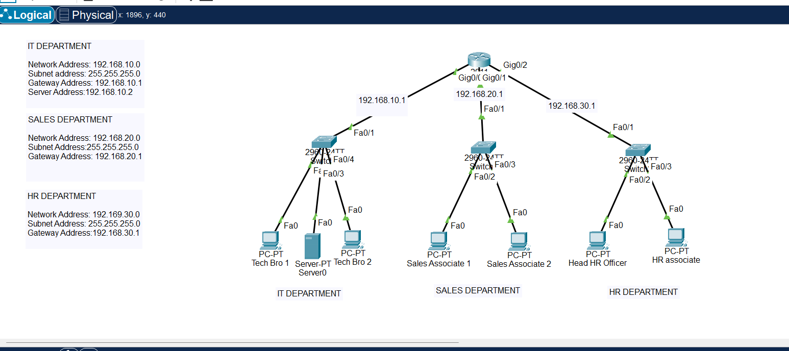
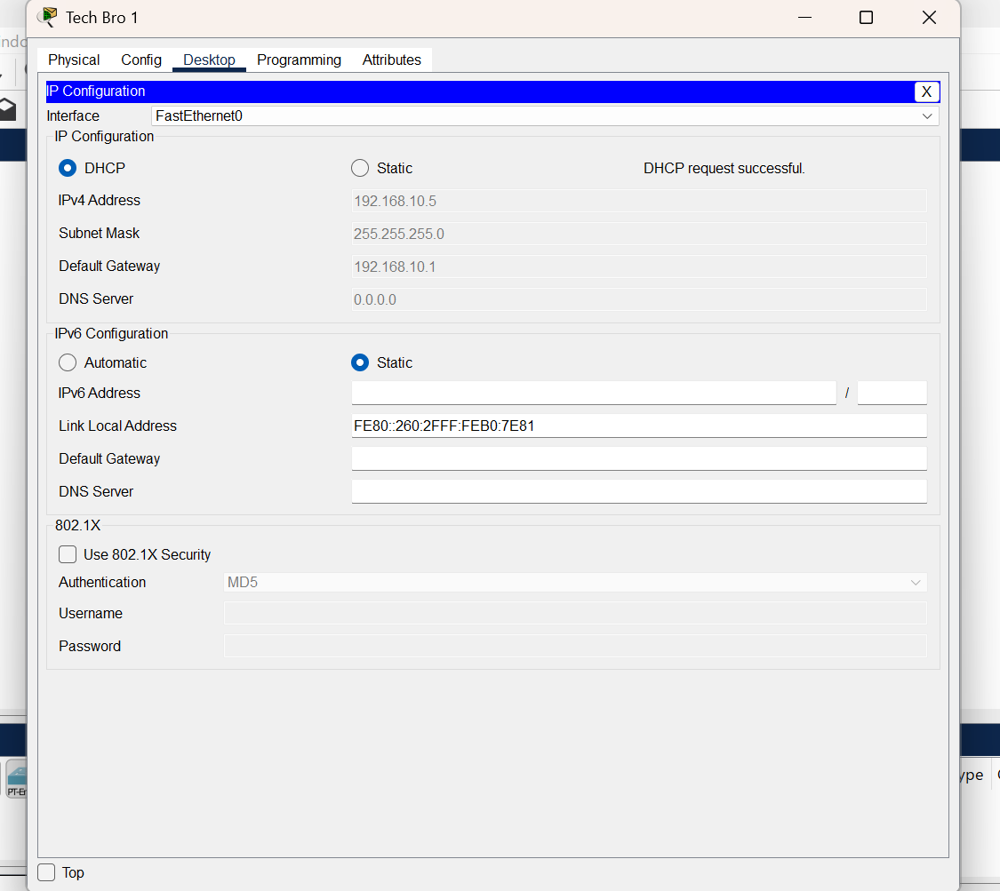
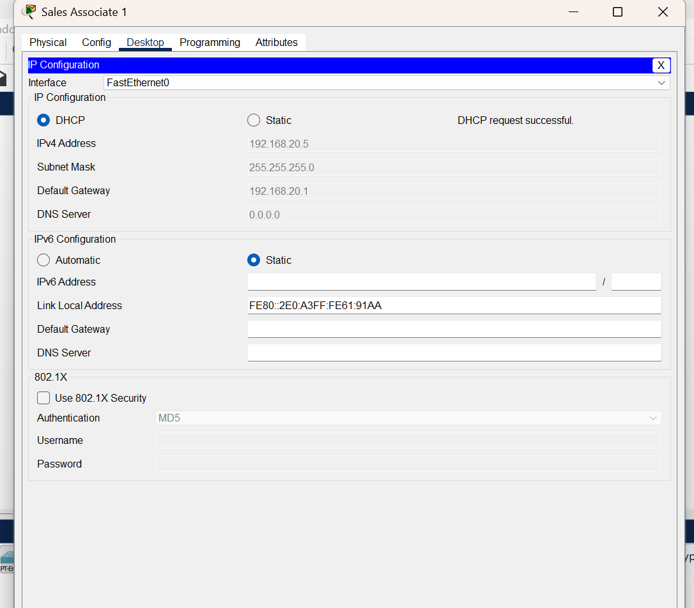
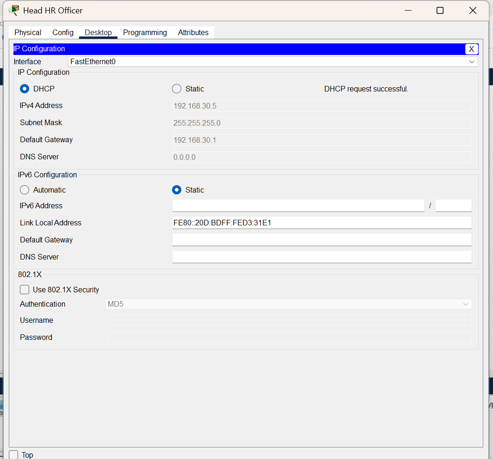
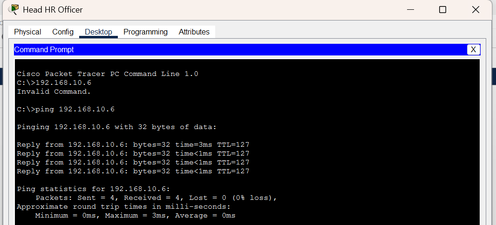
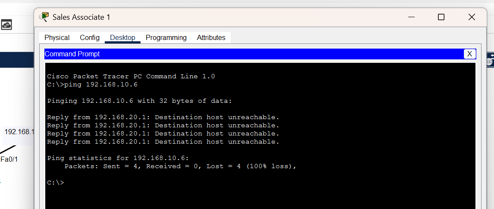
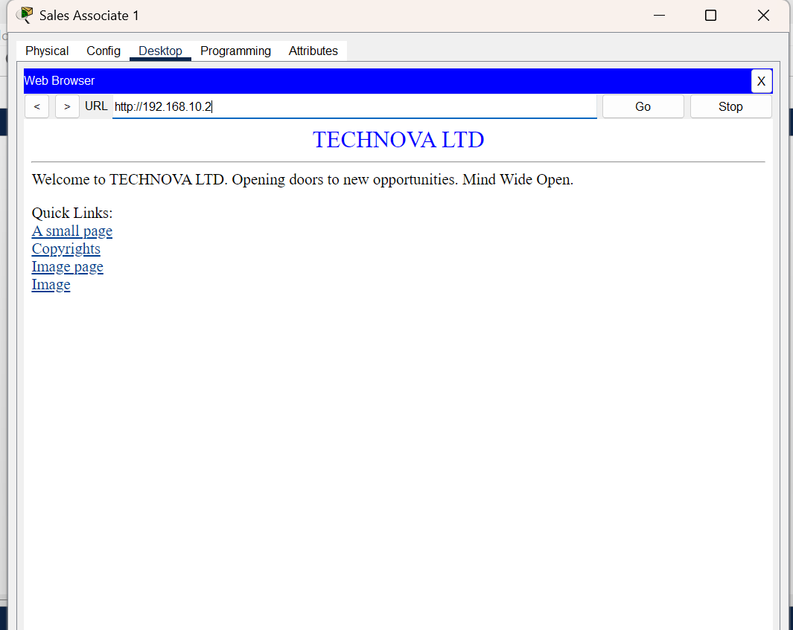

# Departmental Network Segmentation and Access Control

This project demonstrates the design, configuration, and validation of a departmental network using **Cisco Packet Tracer**. The network connects IT, Sales, and HR departments while implementing an **extended Access Control List (ACL)** to restrict selected traffic between departments without disrupting authorized network services.

## Table of Contents

- [Project Overview](#project-overview)
- [Network Topology](#network-topology)
- [Tools and Technologies](#tools-and-technologies)
- [Configuration Steps](#configuration-steps)
- [Results and Findings](#results-and-findings)
- [Security Relevance](#security-relevance)
- [Author](#author)

## Project Overview

The objective was to design and configure a functional network connecting three organizational departments: **IT, Sales, and HR**.

The implementation focused on departmental network segmentation, IPv4 configuration, interdepartmental connectivity, and selective traffic restrictions through an extended ACL.

The project also involved validating network behavior through connectivity tests and verifying continued access to permitted HTTP services.

## Network Topology

The network was designed using the following infrastructure:

- **1 Cisco 2911 Router**
- **3 Cisco 2960 Switches**
- **6 PCs**, with two assigned to each department
- **1 Server** hosted within the IT department

### Departmental IP Addressing

| Department | Network Address | Subnet Mask | Default Gateway |
|---|---|---|---|
| IT | `192.168.10.0/24` | `255.255.255.0` | `192.168.10.1` |
| Sales | `192.168.20.0/24` | `255.255.255.0` | `192.168.20.1` |
| HR | `192.168.30.0/24` | `255.255.255.0` | `192.168.30.1` |

Each department connects to a dedicated switch, with the router providing connectivity between the three networks.

### Network Topology Diagram


## Tools and Technologies

- **Cisco Packet Tracer** — Network simulation and configuration
- **Cisco 2911 Router** — Interdepartmental routing and ACL enforcement
- **Cisco 2960 Switches** — Departmental device connectivity
- **IPv4 and Subnetting** — Network addressing
- **DHCP** — Automatic IP address allocation to end devices
- **Cisco IOS CLI** — Router configuration
- **Extended ACLs** — Selective traffic filtering
- **ICMP/Ping** — Network connectivity validation
- **HTTP** — Server service accessibility testing

## Configuration Steps

### 1. Network Design and Device Deployment

Created a network topology in Cisco Packet Tracer comprising one router, three switches, six PCs, and one server.

Organized the devices into IT, Sales, and HR departmental networks.

### 2. IPv4 Addressing and Configuration

Configured three distinct IPv4 subnets and their corresponding default gateways.

Verified DHCP-assigned IPv4 addresses, subnet masks, and gateways on departmental PCs.

**IT Department IP Configuration**



**Sales Department IP Configuration**



**HR Department IP Configuration**



### 3. Network Connectivity Testing

Performed ICMP ping tests to verify communication between departmental networks.

A successful ping from an HR PC to an IT PC confirmed network reachability.



### 4. Extended ACL Implementation

Configured an extended ACL on the router to restrict ICMP communication from the Sales subnet to the IT subnet while permitting other IP traffic.

The ACL used the following commands:

```text
ip access-list extended SALES_IT
 deny icmp 192.168.20.0 0.0.0.255 192.168.10.0 0.0.0.255
 permit ip any any
```

Applied the ACL inbound on the router interface connected to the Sales network:

```text
interface gig0/0/1
 ip access-group SALES_IT in
```


### 5. Access Control Validation

Tested connectivity from a Sales PC to an IT PC after implementing the ACL.

The ping test failed, demonstrating that the configured ICMP restriction was enforced.


### 6. HTTP Service Validation

Verified that a Sales PC could still access the HTTP service hosted on the IT department server.

This confirmed that the ACL restricted the specified ICMP traffic without blocking permitted HTTP communication.



## Results and Findings

The network implementation produced the following observed results:

| Test | Result | Finding |
|---|---|---|
| HR-to-IT ICMP connectivity | Successful | Interdepartmental network reachability confirmed |
| Sales-to-IT ICMP connectivity | Blocked | Extended ACL restriction enforced |
| Sales-to-server HTTP access | Successful | Permitted application traffic remained accessible |
| Departmental IP configuration | Verified | DHCP-assigned addressing and gateway settings observed |

The results demonstrated the effectiveness of selective traffic filtering in a segmented departmental network.

## Security Relevance

This project demonstrates practical security concepts relevant to **Governance, Risk, and Compliance (GRC)** and network security operations.

- **Network Segmentation:** Organizing departmental systems into separate IP networks supports clearer network boundaries and traffic management.
- **Access Control:** Extended ACLs provide a technical mechanism for enforcing defined communication restrictions.
- **Least Privilege:** Restricting unnecessary communication while maintaining authorized services supports least-privilege principles.
- **Security Control Validation:** Successful and failed connectivity tests provide evidence that configured restrictions behave as intended.
- **Availability:** Preserving HTTP access while blocking selected ICMP traffic illustrates the importance of balancing security restrictions with operational requirements.
- **Evidence-Based Documentation:** Network topology diagrams, configuration screenshots, and test results provide supporting evidence for technical reviews and security assessments.

The implementation highlights how technical controls can support organizational security requirements through defined access rules, testing, and documented evidence.

## Author

**Concord Ekwonna**

- **Field:** Governance, Risk, and Compliance (GRC)
- **Location:** Canada
- **Email:** [concordekwonna@gmail.com](mailto:concordekwonna@gmail.com)
